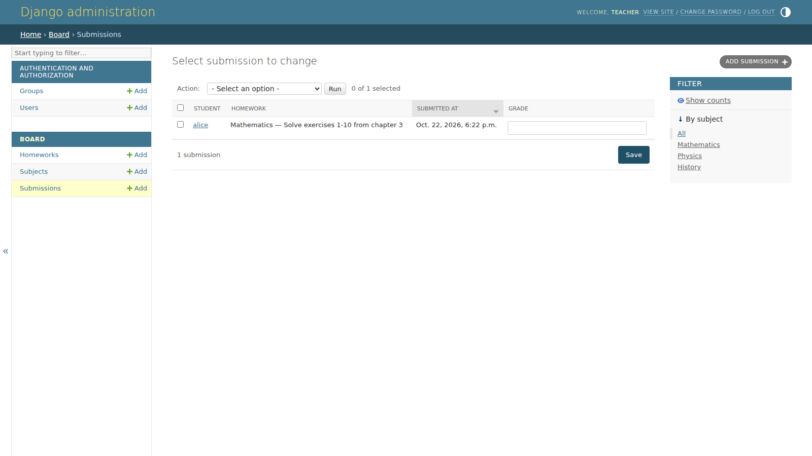
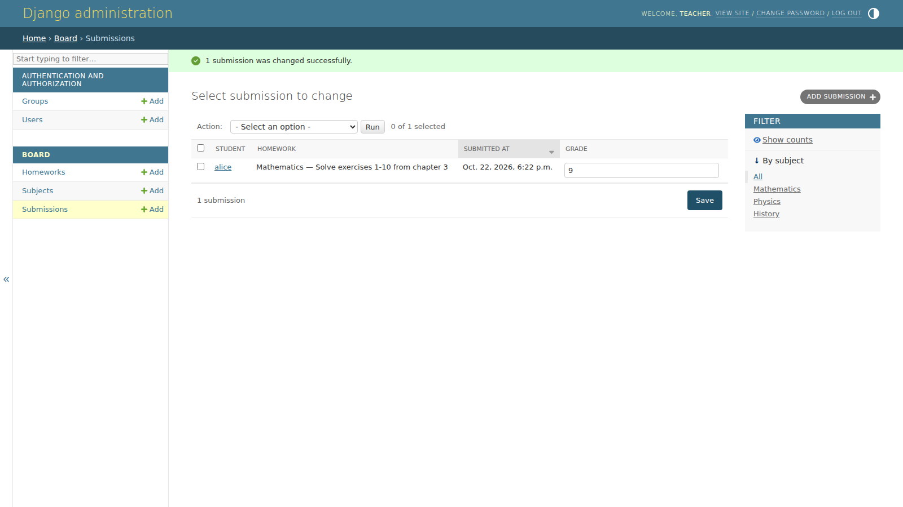
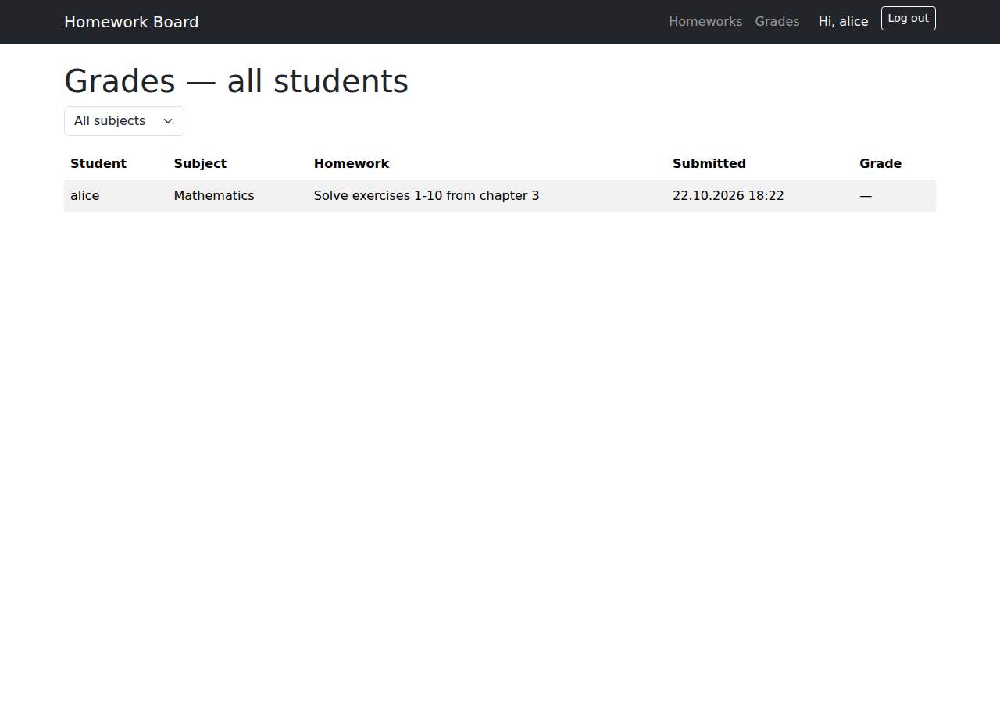
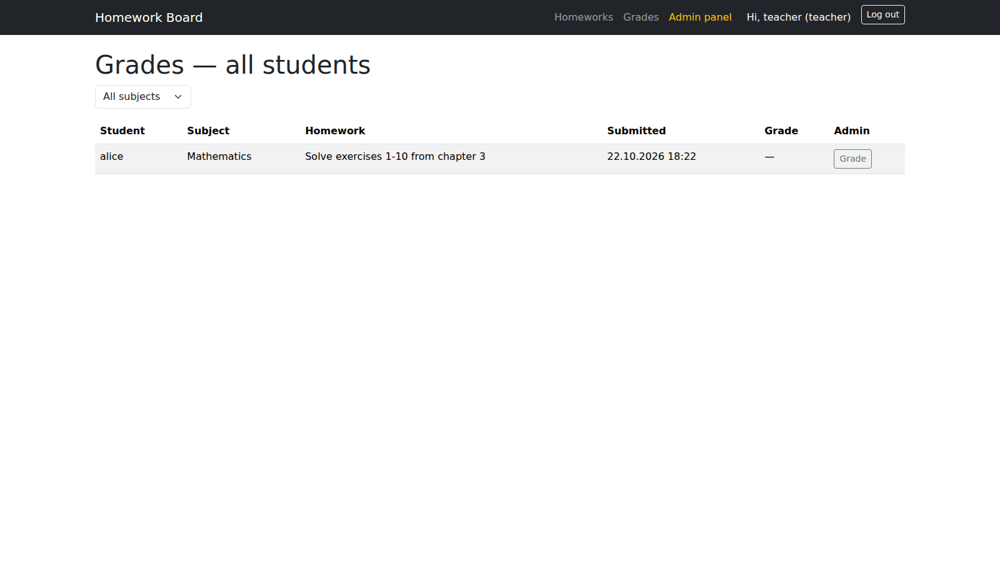
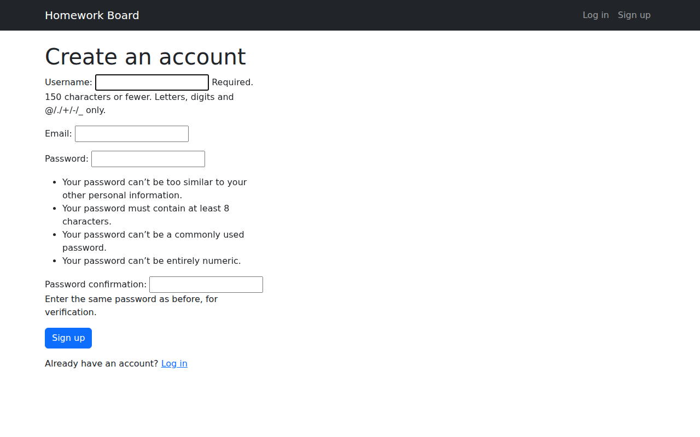
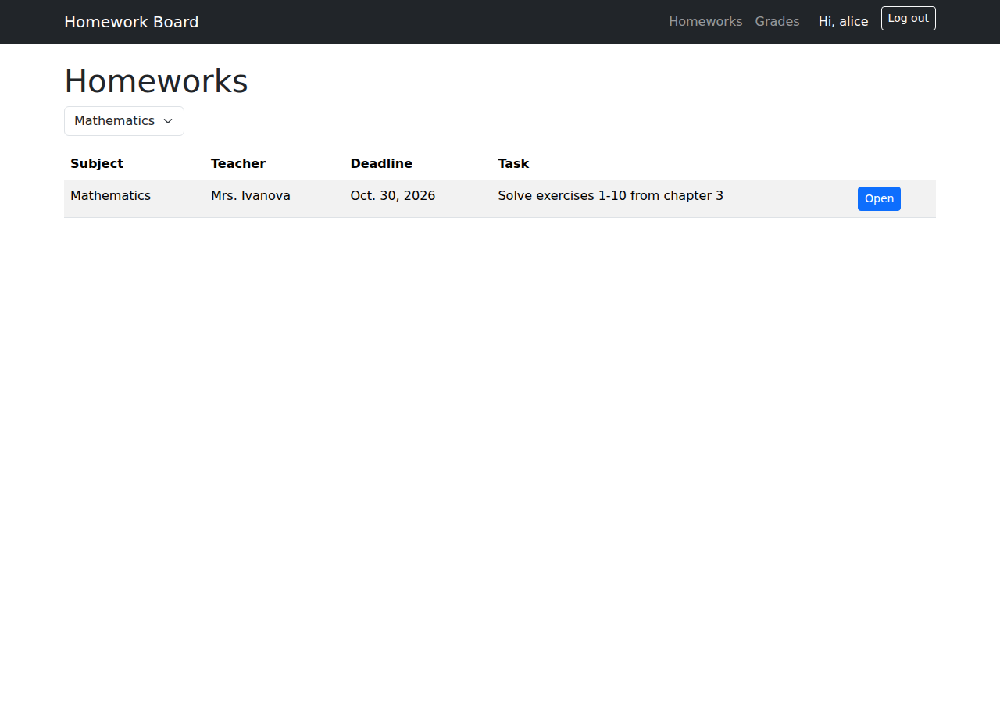
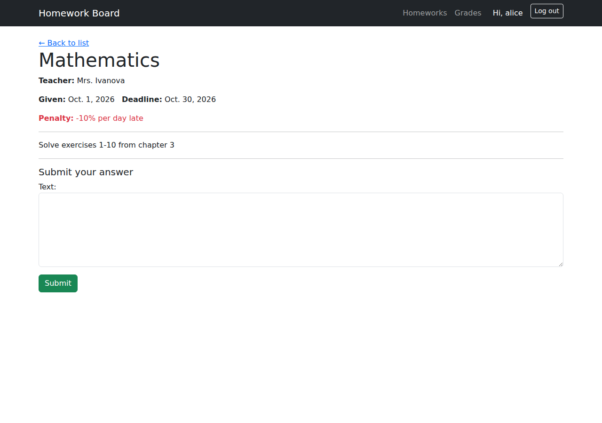
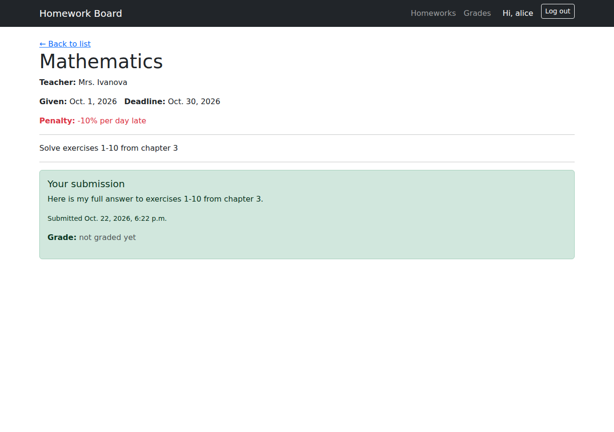
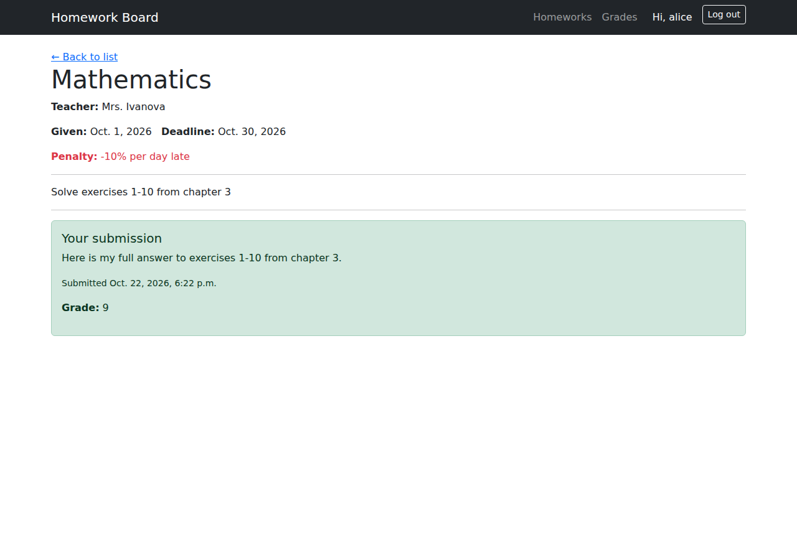

# ЛР2 — Простой сайт на Django

**Вариант 2 — Доска домашних заданий**

Стек: Python 3, Django 6, SQLite (локальная разработка) / PostgreSQL (см. раздел "Переключение на PostgreSQL" в README проекта), Bootstrap 5 (подключён локально как статический файл, без зависимости от CDN).

## Модель данных

Три модели, связанные через `ForeignKey`:

```
Subject (предмет)
  └── Homework (домашнее задание)         [ForeignKey: subject]
        └── Submission (сдача задания)    [ForeignKey: homework, student]
```

- **Subject** — название предмета (`name`). Вынесен в отдельную таблицу вместо текстового поля на `Homework`, чтобы фильтр по предмету был выпадающим списком без опечаток.
- **Homework** — предмет, преподаватель, дата выдачи, дедлайн, текст задания, информация о штрафах за просрочку.
- **Submission** — связывает домашнее задание и студента (`settings.AUTH_USER_MODEL`), хранит текст ответа, время сдачи и поле `grade` (оценка), которое заполняется преподавателем через Django Admin. `unique_together = ('homework', 'student')` — один студент может сдать конкретное задание только один раз.

```python
# board/models.py
from django.conf import settings
from django.db import models


class Subject(models.Model):
    name = models.CharField(max_length=100, unique=True)

    def __str__(self):
        return self.name


class Homework(models.Model):
    subject = models.ForeignKey(Subject, on_delete=models.CASCADE, related_name='homeworks')
    teacher_name = models.CharField(max_length=100)
    date_given = models.DateField()
    deadline = models.DateField()
    text = models.TextField(help_text="What the student needs to do")
    penalty_info = models.CharField(max_length=200, blank=True)

    class Meta:
        ordering = ['-deadline']

    def __str__(self):
        return f"{self.subject} — {self.text[:40]}"


class Submission(models.Model):
    homework = models.ForeignKey(Homework, on_delete=models.CASCADE, related_name='submissions')
    student = models.ForeignKey(settings.AUTH_USER_MODEL, on_delete=models.CASCADE, related_name='submissions')
    text = models.TextField()
    submitted_at = models.DateTimeField(auto_now_add=True)
    grade = models.CharField(max_length=10, blank=True, null=True)

    class Meta:
        unique_together = ('homework', 'student')
        ordering = ['-submitted_at']
```

## Административная панель

```python
# board/admin.py
from django.contrib import admin
from .models import Subject, Homework, Submission


@admin.register(Subject)
class SubjectAdmin(admin.ModelAdmin):
    list_display = ('name',)


@admin.register(Homework)
class HomeworkAdmin(admin.ModelAdmin):
    list_display = ('subject', 'teacher_name', 'date_given', 'deadline')
    list_filter = ('subject',)


@admin.register(Submission)
class SubmissionAdmin(admin.ModelAdmin):
    list_display = ('student', 'homework', 'submitted_at', 'grade')
    list_filter = ('homework__subject',)
    list_editable = ('grade',)
```

`list_editable = ('grade',)` — преподаватель может поставить оценку прямо в списке заявок, не открывая каждую запись отдельно. Это и есть реализация пункта задания *"Администратор должен иметь возможность поставить оценку за задание средствами Django-admin"*.



*После сохранения — оценка проставлена прямо из списка, без открытия отдельной записи:*



## Представления (Views) — функциональный подход (FBV)

Все представления реализованы как функции — для единообразия и простоты объяснения на защите.

```python
# board/views.py
from django.contrib.auth import login
from django.contrib.auth.decorators import login_required
from django.core.paginator import Paginator
from django.shortcuts import render, redirect, get_object_or_404

from .forms import SignUpForm, SubmissionForm
from .models import Homework, Subject, Submission


def signup_view(request):
    if request.method == 'POST':
        form = SignUpForm(request.POST)
        if form.is_valid():
            user = form.save()
            login(request, user)
            return redirect('homework_list')
    else:
        form = SignUpForm()
    return render(request, 'board/signup.html', {'form': form})


@login_required
def homework_list_view(request):
    homeworks = Homework.objects.select_related('subject').all()

    subject_id = request.GET.get('subject')
    if subject_id:
        homeworks = homeworks.filter(subject_id=subject_id)

    paginator = Paginator(homeworks, 5)
    page_obj = paginator.get_page(request.GET.get('page'))

    return render(request, 'board/homework_list.html', {
        'page_obj': page_obj,
        'subjects': Subject.objects.all(),
        'selected_subject': subject_id,
    })


@login_required
def homework_detail_view(request, homework_id):
    homework = get_object_or_404(Homework, pk=homework_id)
    existing_submission = Submission.objects.filter(homework=homework, student=request.user).first()

    if existing_submission:
        return render(request, 'board/homework_detail.html', {
            'homework': homework, 'submission': existing_submission,
        })

    if request.method == 'POST':
        form = SubmissionForm(request.POST)
        if form.is_valid():
            submission = form.save(commit=False)
            submission.homework = homework
            submission.student = request.user
            submission.save()
            return redirect('homework_detail', homework_id=homework.id)
    else:
        form = SubmissionForm()

    return render(request, 'board/homework_detail.html', {'homework': homework, 'form': form})


@login_required
def grades_list_view(request):
    submissions = Submission.objects.select_related('student', 'homework', 'homework__subject').all()

    subject_id = request.GET.get('subject')
    if subject_id:
        submissions = submissions.filter(homework__subject_id=subject_id)

    paginator = Paginator(submissions, 10)
    page_obj = paginator.get_page(request.GET.get('page'))

    return render(request, 'board/grades_list.html', {
        'page_obj': page_obj,
        'subjects': Subject.objects.all(),
        'selected_subject': subject_id,
    })
```

### Формы

```python
# board/forms.py
from django import forms
from django.contrib.auth.forms import UserCreationForm
from django.contrib.auth.models import User
from .models import Submission


class SignUpForm(UserCreationForm):
    email = forms.EmailField(required=False)

    class Meta:
        model = User
        fields = ['username', 'email']


class SubmissionForm(forms.ModelForm):
    class Meta:
        model = Submission
        fields = ['text']
        widgets = {'text': forms.Textarea(attrs={'rows': 6, 'class': 'form-control'})}
```

### Маршруты

```python
# board/urls.py
from django.urls import path
from . import views

urlpatterns = [
    path('', views.homework_list_view, name='homework_list'),
    path('homework/<int:homework_id>/', views.homework_detail_view, name='homework_detail'),
    path('grades/', views.grades_list_view, name='grades_list'),
    path('signup/', views.signup_view, name='signup'),
]
```

```python
# homework_project/urls.py
from django.contrib import admin
from django.urls import path, include

urlpatterns = [
    path('admin/', admin.site.urls),
    path('accounts/', include('django.contrib.auth.urls')),  # login/logout — готовые из Django
    path('', include('board.urls')),
]
```

## Реализованный функционал (по пунктам задания)

| Требование | Реализация |
|---|---|
| Регистрация новых пользователей | `SignUpForm` (на основе `UserCreationForm`) + `signup_view` |
| Просмотр домашних заданий по всем дисциплинам | `homework_list_view` + `homework_list.html` |
| Сдача домашних заданий в текстовом виде | `homework_detail_view` (POST) + `SubmissionForm` |
| Оценка через Django-admin | `list_editable = ('grade',)` в `SubmissionAdmin` |
| Таблица оценок всех учеников | `grades_list_view` + `grades_list.html` |
| Пагинация | `Paginator` — 5 заданий/страница в списке заданий, 10 записей/страница в таблице оценок |
| Фильтрация | GET-параметр `?subject=<id>` на обеих страницах, выпадающий список предметов |
| Стилизация (CSS) | Bootstrap 5, подключён как локальный статический файл (`board/static/board/bootstrap.min.css`), навигационная панель, таблицы, формы |
| Разграничение прав админа/пользователя в браузере | `` в `base.html` (ссылка на панель администратора) и в `grades_list.html` (дополнительная колонка с прямой ссылкой на редактирование оценки в Django Admin) |

### Разграничение прав — фрагмент шаблона

```html
<!-- board/templates/board/base.html -->

    <a class="nav-link text-warning" href="/admin/">Admin panel</a>

```

```html
<!-- board/templates/board/grades_list.html -->
<th>Student</th><th>Subject</th><th>Homework</th><th>Submitted</th><th>Grade</th>
<th>Admin</th>
...

    <td><a href="/admin/board/submission/{{ submission.id }}/change/" class="btn btn-sm btn-outline-secondary">Grade</a></td>

```

Обычный пользователь (студент) видит таблицу оценок без последней колонки и без пункта меню "Admin panel". Преподаватель (`is_staff=True`) видит оба элемента — это проверено вручную: аккаунт `alice` (обычный пользователь) не видит колонку "Admin", аккаунт `teacher` (суперпользователь) видит.

*Страница `/grades/` под обычным пользователем (alice) — колонки "Admin" нет:*



*Та же страница под преподавателем (is_staff=True) — появляются пункт меню "Admin panel" и колонка "Admin" с прямой ссылкой на редактирование в Django Admin:*



## Тестовые данные

Для воспроизводимого наполнения базы использована management-команда:

```python
# board/management/commands/seed_demo_data.py
from django.core.management.base import BaseCommand
from django.contrib.auth.models import User
from board.models import Subject, Homework
import datetime

class Command(BaseCommand):
    help = "Creates demo students, subjects and homeworks"

    def handle(self, *args, **options):
        if not User.objects.filter(username='alice').exists():
            User.objects.create_user('alice', password='AlicePass123')
        # ... (создаёт ещё одного студента, 3 предмета и 3 задания)
        self.stdout.write(self.style.SUCCESS("Demo data ready."))
```

Запуск: `python manage.py seed_demo_data`

## Проверка работы (end-to-end тест)

Полный цикл был протестирован вручную: регистрация → вход → просмотр списка заданий с фильтром по предмету → открытие задания → отправка ответа → повторный визит на страницу (форма скрыта, показана уже сданная работа) → преподаватель выставляет оценку через `list_editable` в админке → студент видит оценку на своей странице.

```
=== Alice submits homework 1 ===
HTTP 302 (redirect after successful POST)

=== Alice revisits homework 1 — sees her own submission, not the form ===
<h5>Your submission</h5>
<p>Here is my answer to exercises 1-10</p>

=== Teacher view of /grades/ — sees Admin column, Alice does not ===
teacher: 1 "Admin" button visible
alice:   0 "Admin" buttons visible

=== After grading via admin, Alice's page shows the grade ===
<strong>Grade:</strong> 9
```

**Регистрация нового пользователя:**



**Список домашних заданий, фильтр по предмету "Mathematics":**



**Открытая страница задания — форма сдачи ответа (пока не сдано):**



**Та же страница сразу после отправки ответа — форма исчезла, показан текст сдачи:**



**Та же страница после того, как преподаватель поставил оценку через админку:**



## Запуск проекта

```
python -m venv .venv
.venv\Scripts\activate
pip install -r requirements.txt
python manage.py migrate
python manage.py seed_demo_data
python manage.py createsuperuser
python manage.py runserver
```

Тестовые аккаунты (создаются `seed_demo_data`): `alice` / `AlicePass123`, `bob` / `BobPass123`.

## Переключение на PostgreSQL

Подробная инструкция — в `README.md` проекта. Кратко: установить `psycopg2-binary`, заменить секцию `DATABASES` в `settings.py` на параметры PostgreSQL-подключения, выполнить `migrate` заново. Код моделей и представлений при этом не меняется — в этом и есть смысл Django ORM.

## Вывод

Реализован сайт на Django по паттерну MVT: три связанные модели (`Subject`, `Homework`, `Submission`), регистрация и аутентификация пользователей, разграничение прав администратора и обычного пользователя в клиентском интерфейсе, сдача и оценивание домашних заданий, пагинация и фильтрация по предмету, стилизация через Bootstrap. Весь функционал протестирован под двумя ролями (студент и преподаватель).
